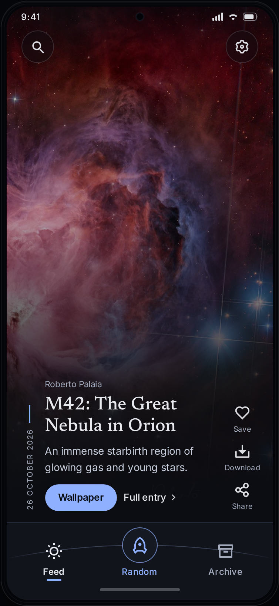
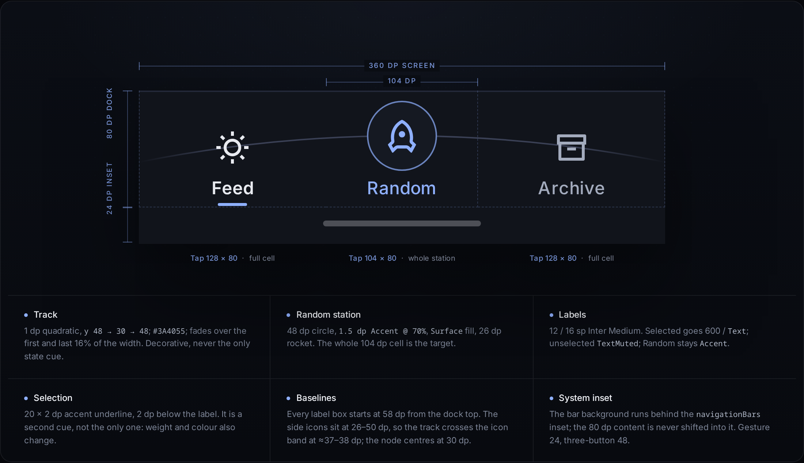
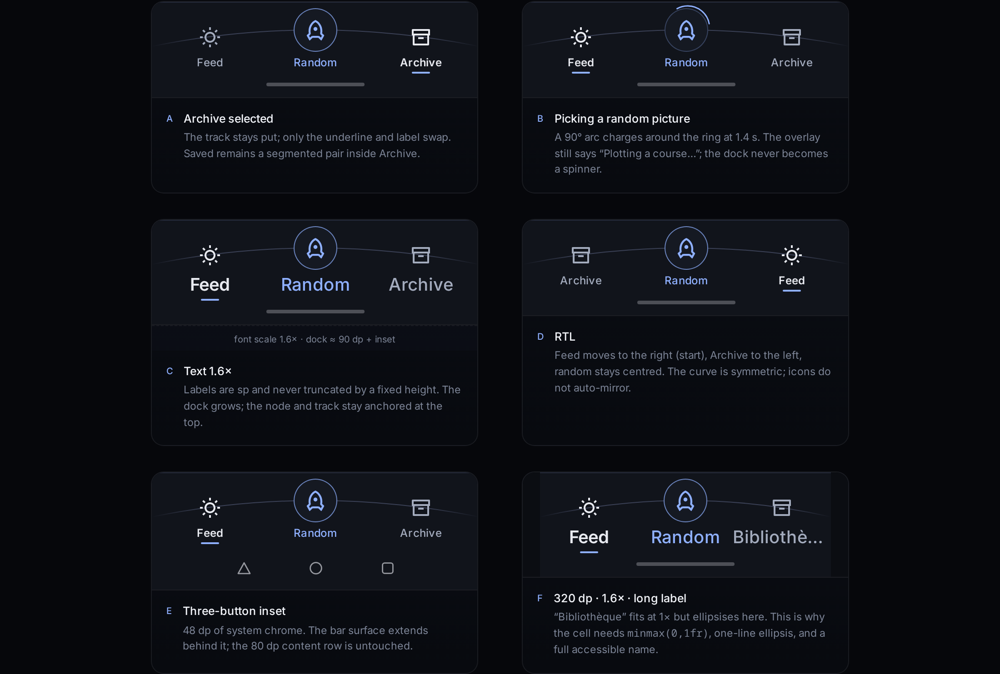

# Mohakash · navigation study 02 — **Orbit Line**

**Status:** recommended direction · design lab only · no production files touched
**Mockup:** [mockup.html](mockup.html) · **360 dp:** [mockup-360.png](mockup-360.png) · **411 dp:** [mockup-411.png](mockup-411.png) · **anatomy:** [mockup-anatomy.png](mockup-anatomy.png) · **states:** [mockup-states.png](mockup-states.png)
**Companion docs:** [Compose implementation notes](compose-notes.md) · [Tradeoffs and failure cases](tradeoffs.md)

---

## 0. The problem, measured

The current bar is a 72 dp rail with an 80 dp rocket disc floating 16 dp above its top edge. Inside the disc is a 62 dp solid periwinkle core. It is memorable, and it works as a beacon — but not as a calm navigation bar.

| Symptom | Evidence in the current implementation |
| --- | --- |
| The action overpowers the destinations | 80 dp outer disc, 62 dp solid accent core, 31 dp rocket. The accent fill alone is ≈ 3,019 dp². |
| The bar's silhouette is broken | The disc is offset 16 dp above the bar. The bar surface stops; the disc floats over the feed. |
| Content is covered | The disc's top 16 dp sits inside the feed's reading area, in the centre where the overlay's pills sit. |
| The rocket has no visible label | Only `contentDescription` — sighted users get an icon, not a word. |
| The spacing is tight where it matters | The 80 dp disc sits in a 96 dp slot: 8 dp of air on either side. |
| It reads as a FAB, not a station | Two concentric circles and a saturated core; the strongest shape in the app belongs to a secondary action. |

**What is already right and should stay:** the solid `SurfaceRaised` bar (readable over any picture), the three-part order Feed · Random · Archive, the Archive + Saved segmented pair, Settings at the top right, the periwinkle accent, the 12 sp labels, and the restrained dark palette.

> The goal is not to make the rocket smaller. It is to stop making it *heavy*. Prominence can come from isolation, position and contrast instead of diameter and fill.

---

## 1. The direction

Three principles for the dock:

1. **Prominence by position, not mass.** The random action should be the most *isolated* element, not the largest painted one.
2. **One shared geometry.** The three controls should look like they belong to one instrument, not two tabs with a button parked between them.
3. **Calm at rest; motion only while working.** The selected state is quiet; only a real in-progress state may move.

Orbit, instrument panel, launch rail and horizon are all valid spatial metaphors. The three concepts below are genuinely different structures, not three skins.

---

## 2. Concepts

### 2.1 Orbit Line — *recommended*

**Idea.** The dock is a course chart. A single 1 dp orbital track runs edge to edge, fades into the bar at both ends, and reaches its apex exactly at the centre of the rocket. Feed and Archive sit on the track as station marks; Random is the one body in orbit — a 48 dp ringed station at the apex, with its label underneath.

```text
┌──────────────────────────── 360 dp ────────────────────────────┐
│ ·────────────────────────╮            ╭──────────────────────· │  1 dp track
│                          ╰────( ▲ )───╯                        │  48 dp ring
│   ☀  Feed                 Random                      Archive ▤ │  24 dp icon
│   ▔▔▔                                                          │  20 × 2 dp
│                                                                │
│                    ▁▁▁▁▁▁▁▁▁▁▁▁▁                               │  system inset
└────────────────────────────────────────────────────────────────┘
    |<-------- 128 dp ------->|<-104->|<------- 128 dp -------->|
         ↑ selected underline       ↑ 26 dp rocket / 30 dp centre
```

*Side elevation (dp from the top of the bar):*

```text
y = 0       ── top hairline, 1 dp Border
y = 6       ┌──────────────┐
y = 30      │   node centre = track apex
y = 48      ··· track leaves at the screen edges
y = 54      └──────────────┘
y = 58      Feed / Random / Archive labels start here (12 / 16 sp)
y = 76      ▔▔ selected underline, 20 × 2 dp
y = 80      content bottom
y = 80+     navigationBars inset (24 gesture / 48 three-button)
```

**Why it works**

- The random control is still the only thing at the centre, but it is framed by 28 dp of clear space on each side (104 dp cell − 48 dp ring), against 8 dp around the old 80 dp disc. It is more isolated, not less.
- The ring is the only circular accent in the dock, the label is the only accent text, and the track apex is the one highest point. Three independent cues point at Random without a 62 dp slab.
- Feed and Archive regain visible labels and a shared baseline; the track gives them a relationship instead of leaving them as two unrelated tabs.
- Nothing protrudes. The 16 dp of covered content is gone.
- The track is 1 dp and fades out; it is an enhancement, not a dependency. Remove it and the dock still works (tabs, node, labels, underline). That is the test of a detail that belongs.

**What it costs**

- The bar grows 72 → 80 dp of content. Net reserved height is +8 dp, but the old disc covered 16 dp of the feed; the clean reading band is larger.
- The track is quiet on low-end panels. It is decorative; the selected state never depends on it.
- The rocket is less loud at first glance than before. That is the trade: calm, with the same centrality and a clearer label.

**Key dimensions.** Dock 80 dp + inset · centre cell 104 dp · node 48 dp / ring 1.5 dp Accent @ 70% / rocket 26 dp · side icons 24 dp · labels 12 / 16 sp · underline 20 × 2 dp · track 1 dp, edges y 48, apex y 30, `#3A4055`, 16% edge fade.

---

### 2.2 Launch Bay — *the asymmetric option*

**Idea.** Treat Random as a command module, not a destination. A dedicated 108 dp launch bay sits at the leading edge of a 72 dp dock, separated by a vertical hairline and a small vertical rail that rises from the 44 dp portal to the top rule. Feed and Archive become two compact station cells on the remaining rail. Random is prominent because it is *framed and named*, not because it is huge.

```text
┌───────────────┬─────────────────────────────────────────────────┐
│       ╷       │                                                 │
│     ( ▲ )     │        ☀ Feed                Archive ▤          │
│     Random    │                                                 │
│    108 dp bay │        126 dp                126 dp              │
├───────────────┴─────────────────────────────────────────────────┤
│                       system inset                              │
└─────────────────────────────────────────────────────────────────┘
  ↑ 44 dp portal, 1 dp rail, SurfaceStrong bay
```

**Why it is interesting**

- It says what the rocket actually is: a launch command. The bay is a module with a job, and the two destinations become a quiet library rail.
- No floating disc, no protrusion, no centre bullseye. The hierarchy is explicit and asymmetric, which can feel more like an instrument panel than a symmetric tab bar.
- It puts the most playful action at the leading edge, giving the bar a clear reading start.

**Why it is not the recommendation**

- It displaces the home destination. Feed is the app's primary screen; a secondary action at the start fights both habit and RTL (the bay flips to the right in RTL, so the "start" changes meaning).
- The vertical rail and bay border add chrome; the bar becomes busier at 72 dp than the Orbit Line at 80 dp.
- 44 dp portal plus 11 sp label compresses the random label and the destination cells; it is the least accessible of the three at large font scales.
- The asymmetry is a deliberate bet. If the product wants a "mission console", this is the more radical option; it needs user testing, not a quiet rollout.

---

### 2.3 Horizon Crest — *the poetic option*

**Idea.** The dock's top edge itself becomes a shallow horizon: an 8 dp crest at the centre, a 1 dp hairline following the curve, SurfaceRaised below. The random station (52 dp) sits under the crest; Feed and Archive sit lower at the ends, on the same label baseline. There is no internal line at all — the silhouette is the space.

```text
           ╭────────── 8 dp crest ──────────╮
          ╱                                 ╲
         ╱            ( ▲ )                   ╲
        ╱             Random                   ╲
       ╱      ☀ Feed             Archive ▤       ╲
      ╱───────────────────────────────────────────╲
      │                system inset               │
      ╰───────────────────────────────────────────╯
```

**Why it is interesting**

- It is the most atmospheric of the three and the closest to the app's subject: a horizon at night, with the rocket rising over it.
- There is no ornament inside the bar; the shape does all the work. Random is prominent through the crest and its 52 dp ring.
- It keeps the symmetric Feed-first order.

**Why it is not the recommendation**

- On a solid dark bar, an 8 dp curve is easy to read as a rendering bug rather than a horizon. The reference (the current bar) is a straight rule; users have no reason to interpret the curve as intentional.
- It needs a custom bar `Shape`, a separately drawn hairline, and careful handling of the area above the curve. The Scaffold reserves the crest height, so the feed's bottom seam becomes a shaped edge — more implementation risk for an effect that is barely visible at 1×.
- The crest adds only 8 dp while the node, its label and the inset all compete for the same 88 dp; at large font scales that budget is tight.
- It is a beautiful idea for a splash screen or a widget; as a persistent navigation bar it is too quiet to justify the complexity.

---

### 2.4 Comparison

| Criterion | **Orbit Line** | Launch Bay | Horizon Crest |
| --- | --- | --- | --- |
| Random prominence | High: centre + only ring + track apex | High: framed bay, placed first | High: lifted by the crest |
| Calm | High | Medium — chrome and asymmetry | High, but ambiguous |
| Balance | Symmetric | Deliberately asymmetric | Symmetric |
| Feed-first order | Yes | No | Yes |
| Visible labels | All three, shared baseline | All three, tighter | All three |
| RTL | Symmetric, trivial | Bay flips to the right | Symmetric |
| Narrow / large text | Grows; labels ellipsise gracefully | 72 dp, 11 sp, tight | 88 dp crest, tight |
| Implementation cost | Medium — one Canvas | Low — layout only | High — custom shape + inset seam |
| Risk | Track may read as decoration | Displaces the home tab | Silhouette may read as a bug |
| Verdict | **Recommend** | Explore if the product wants a console | Not for v1 |

---

## 3. The recommendation



**The single most important idea: a track, not a totem.**

The rocket is not a button sitting on top of a bar; it is a station on the bar's orbit. The track gives the two quiet destinations a common spatial frame, and it gives the random action a *position* rather than a *size*. The visual weight moves from a 62 dp accent slab to a 1 dp line, a 1.5 dp ring and a word.



### What changes

| | Current | Orbit Line |
| --- | --- | --- |
| Random visual | 80 dp disc / 62 dp accent core | 48 dp ring / 26 dp rocket |
| Protrusion above the bar | 16 dp | 0 |
| Accent fill on the random action | ≈ 3,019 dp² | ≈ 220 dp² ring + 12 sp label |
| Clear space around the random | 8 dp each side | 28 dp each side |
| Random label | none visible | “Random”, 12 sp Accent + action label for TalkBack |
| Centre cell | 96 dp | 104 dp |
| Dock content height | 72 dp | 80 dp |
| Selected cue | tint / weight | tint + weight + 20 × 2 dp underline |
| Navigation geometry | flat bar | 1 dp orbital track + station |
| Random touch target | 96 × 72 dp | 104 × 80 dp (whole cell) |
| Labels | 12 sp, under icons | 12 / 16 sp, same baseline, ellipsis-safe |

The bar reserves 8 dp more height, but removes 16 dp of floating content. The reading overlay is higher and clean; the dock is calmer; the random action is easier to name and easier to hit.

### What deliberately stays

- Solid `SurfaceRaised` — no translucency, no glass on the bar.
- Feed · Random · Archive, Settings top right.
- Archive + Saved as one destination with a segmented pair.
- 12 sp labels, the existing type ramp, the single periwinkle accent, and the Remix icons.
- The feed's tap-to-hide-chrome behaviour and the random picker overlay ("Plotting a course…").

### Why not just shrink the old circle?

A 48 dp disc alone would look like a FAB that lost its nerve: still a floating object, still without a label, still unrelated to the two destinations. The station-on-a-track is the difference between a smaller button and a navigation instrument. The track is what makes the smaller circle feel intentional.

### Why not three equal tabs?

Random is not a destination; it is an action that navigates into the feed. Making it a third tab would bury the one playful move in the app and imply a state it does not have. The current split (two destinations + one action) is correct; the new geometry makes that hierarchy legible.

### What to watch

- The track is deliberately 1 dp. If review finds it invisible on device, raise it to `#454C63` or drop it; the nav should not depend on it.
- If Random feels under-prominent in hand, raise the ring to 2 dp / 80% or the node to 52 dp. Do not restore the 80 dp disc.
- If the label “Random” tests poorly, use “Surprise” or keep “Random” visually and make the action label more explicit for TalkBack; measure first.

---

## 4. Validation summary

Rendered and checked at:

- 360 × 800 dp and 411 × 891 dp, feed selected, with the real M42 APOD frame and the app's reading overlay.
- 320 dp, 360 dp at 1.6× font scale, 320 dp at 1.6× with a long label (`Bibliothèque`), RTL, and 3-button navigation inset (48 dp).
- The 1.6× bar grows to ≈ 90 dp of content and the labels are never clipped; the long label ellipsises and keeps its full accessible name.
- 3-button inset: the bar surface runs behind 48 dp of system chrome; the 80 dp content row is untouched.
- The gesture inset is 24 dp in the mockup. The implementation uses the real `navigationBars` inset, not a hard-coded value.

Full detail, numbers and mitigations: [tradeoffs.md](tradeoffs.md).



---

## 5. Implementation in one paragraph

Keep `MohakashBottomBar`'s signature and replace its contents: an 80 dp content row (`heightIn(min = 80.dp)`) with a `1fr · 104 dp · 1fr` grid, a `drawWithCache` orbital path behind it, a 48 dp ringed random cell, and a `navigationBars` spacer below. The labels reuse `MohakashTextStyles.Caption`; the selected item gets a 20 × 2 dp accent underline whose width animates from 0 to 20 dp. The orbit is one quadratic path with a horizontal gradient; if the picking state can be hoisted, the random ring can optionally show a 90° progress arc while a pick is in flight. The whole cell is the touch target; Random is `Role.Button` with `onClickLabel`, never a selected tab; the track is decorative. No new drawables are needed — `ic_today_24`, `ic_archive_24` and `ic_rocket_24` already exist; add a `nav_random` string and the new size tokens. Full tree, code sketches, semantics, insets and tests: [compose-notes.md](compose-notes.md).

---

## 6. Files

```text
design-lab/nav-orbit/
├── proposal.md            this document
├── mockup.html            live mockup: 360 / 411, anatomy, states
├── compose-notes.md       layout tree, tokens, drawing, motion, a11y, tests
├── tradeoffs.md           narrow, large text, long labels, RTL, landscape, insets
├── mockup-360.png         360 × 800 phone crop, 2×
├── mockup-411.png         411 × 891 phone crop, 2×
├── mockup-anatomy.png     2× construction drawing with dimensions
├── mockup-states.png      A–F states and edge cases
├── mockup.png             full board, 1.5×
├── render.js              optional Playwright script used to produce the PNGs
└── assets/
    ├── apod-orion.jpg     current APOD frame, © Roberto Palaia — context only, not shipped
    └── fonts/             Inter + Newsreader, copied from the app for accurate rendering
```

Open **[mockup.html](mockup.html)** in a browser; it is self-contained apart from the image and fonts in `assets/`. The PNGs are 2× crops for review. Nothing outside `design-lab/nav-orbit/` was modified.
