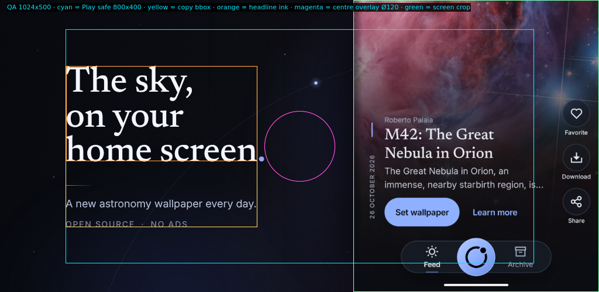

# mohakash — feature graphic & campaign art direction

**Asset:** `featureGraphic-1024x500.png` · 1024 × 500 px · 8-bit sRGB · no alpha · 453,388 bytes
**Source:** `feature.html` (all layout is CSS) · render with `./render.sh`
**Optional cut:** `og-1200x630.png` · 1200 × 630 px · same system, opened up for social/OG

> The sky, on your home screen.
> A new astronomy wallpaper every day.

---

## 1. The idea

A page from an astronomy journal, with the app's own sky bleeding off the right edge.

The composition is deliberately two-temperature: a nearly black editorial margin on the left, and a bright, full-bleed crop of the real app on the right. The crop is not a device mock-up. There is no drawn bezel, no invented status bar, no fake hardware. It is the actual 1080 × 2400 screenshot, vertically cropped and printed to the edge of the canvas, so the app is presented as a window rather than a product shot. The in-app credit line, date, title, “Set wallpaper” button and bottom navigation all remain visible — proof, not decoration.

This cut is deliberately stripped back. There is no wordmark, no “Daily astronomy · Live wallpaper” kicker and no journal subline. The store listing already supplies the icon, title and developer name, so the graphic is free to behave like a cover. What is left is one display line, one product line, one small factual colophon, and one image. The only brand gestures are the orbit — the mark's ring-and-dot logic drawn at poster scale — and the app's own nav mark inside the screen. The headline is the loudest thing in the frame; the supporting line says what the product is; nothing else competes.

The final full stop of the headline is Glow. A single 1 px orbit arc passes behind the type at 10%, with one small body at `(540, 142)`. The atmosphere behind the screen is a heavily defocused, darkened spill made from the same nebula, masked so it only leaks into the gutter and the top of the frame. The fine grain (4.5%, overlay) keeps the large dark field from banding and gives the PNG a printed quality.

There are no badges, ratings, awards, device frames, fake UI, glass panels, NASA marks or price claims. The one accent is Glow `#8FA5FF`, used for the full stop, the orbit, the hairline rule and the separators.

---

## 2. Composition and grid

| Field | x | y | Width | Height | Role |
|---|---|---|---|---|---|
| Canvas | 0 | 0 | 1024 | 500 | exact Play / F-Droid asset |
| Editorial column | 112 | — | 358 | — | maximum headline measure |
| Copy ink bbox | 112 | 113 | 327 | 275 | measured from the rendered PNG |
| Gutter | 439 | — | 165 | — | negative space; orbit body; 120 px badge |
| App window | 604 | 0 | 420 | 500 | real screenshot crop, full-bleed right/top/bottom |

The 112 px left margin is the conservative Play safe-area inset, not a decorative choice. The 327 px ink block keeps the widest headline line well left of the centre. The 165 px gutter runs from the end of the headline (x = 439) to the screen (x = 604); the play badge lands in it and is intentionally empty.

**Vertical rhythm**

| Element | CSS top | Ink top | Ink bottom | Notes |
|---|---|---|---|---|
| Headline | 114 | 113 | 275 | 62 px / 0.96, three lines, Newsreader |
| Hairline rule | 316.5 | 317 | 317 | 44 × 1 px, Glow gradient |
| Product line | 335.5 | 342 | 358 | 18 px / 1.5, Inter Regular |
| Colophon | 377.5 | 379 | 388 | 14 px / 1, Inter Medium, 0.12 em |

The block is optically centred: 113 px above the headline ink and 112 px below the colophon. The headline's own centre (y ≈ 194) sits above the group centre (y ≈ 250); the product line and colophon weight the lower half, which stops the composition from feeling top-heavy. The empty upper field is the sky above the title, not dead space; the orbit body and the faint stars keep it alive.

**The orbit**

SVG circle centre `(780, 735)`, radius `640`, stroke `#8FA5FF` at 10%, 1 px. The small body sits at `(540, 142)`: a 2.6 px `#CBD7FF` core inside an 11 px radial Glow halo. At full size it is a planet on a line; at thumbnail it is a single star. It is the mark's ring-and-dot logic applied to the whole canvas, without recolouring or redrawing the logo (the logo itself is intentionally absent from this cut).

**The app window**

| Property | Value |
|---|---|
| Panel | `left: 604px; top: 0; width: 420px; height: 500px` |
| Screenshot | 1080 × 2400, displayed at 420 px wide (scale 0.3889) |
| Vertical crop | source y = 1114 → 2400 (the last 1286 px) |
| CSS offset | `top: -433.3px` = `-(1114 × 420 / 1080)` |
| Included | lower nebula, Roberto Palaia credit, title, explanation, Set wallpaper, Learn more, real bottom nav |
| Excluded | status bar and the app's top header — the graphic supplies its own type |
| Edge | 16 px left falloff + 1 px Glow-tinted inner rim; no device frame |

The whole width of the screenshot is used; only the vertical axis is cropped. That is why the action column on the right is intact and the screen ends naturally at the canvas edge. The crop deliberately starts below the status bar and above the credit so the photograph is credited inside the artwork.

---

## 3. Exact type and colour

**Fonts** — both are the app's own font files, copied to `assets/fonts/`:

- **Newsreader Medium** (`newsreader_medium.ttf`, SIL OFL 1.1) — headline only, 62 px / 0.96, tracking −0.012 em, Starlight `#F4F6FF`.
- **Inter Regular** (`inter_regular.ttf`, SIL OFL 1.1) — product line, 18 px / 1.5, `#BAC3DA`.
- **Inter Medium** (`inter_medium.ttf`, SIL OFL 1.1) — colophon 14 px / 1 / 0.12 em, `rgba(138,147,178,.88)`.
- **No wordmark in this cut.** The store icon and title carry the name; the app's nav mark is visible inside the screen. `assets/mohakash-horizontal-reversed.svg` is kept for other crops but is not part of this composition.

| Token | Hex | Used for |
|---|---|---|
| Ink (app background) | `#0B0D12` | base, screen surround, fade |
| Deep Space | `#0B1020` | right end of the base gradient |
| Starlight | `#F4F6FF` | headline |
| Glow | `#8FA5FF` | full stop, orbit, rule, separators |
| Dust | `#8A93B2` | colophon (at 88% composite) |
| Subline tint | `#BAC3DA` | the one lighter body tone |
| App accent | `#8FB0FF` | already inside the app UI; not added to the frame |
| Nova Blue | `#4F6BFF` | low-opacity auras only, never as text |

**Background layers:** base `linear-gradient(100deg, #07090E 0%, #0B0D12 44%, #0B1020 100%)`, a radial vignette, two very low-opacity Nova Blue auras, the ambient spill at 30%, the orbit, twelve fixed stars, and grain at 4.5% overlay. No layer is random at render time.

**Contrast (WCAG, against `#0B0D12`):** headline 18.0:1 · product line 11.0:1 · colophon composite 5.2:1 · Glow 8.3:1. The smallest designed text is 14 px; the product line is 18 px; the headline is 62 px.

---

## 4. Safe-area and dimension checks

**File checks** (`identify` / PIL, run by `render.sh`):

```
OUT  PNG  1024x500  srgb  3.0  sRGB  depth=8
OK   1024x500  mode=RGB  no alpha=True
```

- Exact 1024 × 500; 8-bit sRGB; 3 channels, no alpha; 453,388 bytes (well under Play's 15 MB).
- Play's JPEG / 24-bit PNG requirement is satisfied; no transparency.
- Text minimum: 14 px (colophon); product line 18 px; headline 62 px.

**Play safe area:** conservative 800 × 400 centre zone at x 112–912, y 50–450.

- All designed copy lives in x **112–439**, y **113–388** — inside the zone: flush with its left edge, 63 px below its top edge, 62 px above its bottom edge, 473 px clear on the right. On the canvas itself the margins are 112 px left, 113 px top and 112 px bottom.
- The in-screen title and credit sit at x ≈ 643–880, y ≈ 186–320 — also inside the zone. The only in-screen text beyond x 912 is the decorative Favorite / Download / Share column, which is not claim-critical and may be cropped.
- **Centre play badge:** tested with a 120 px circle at (512, 250). It spans x 452–572, y 190–310. The nearest headline ink ends at x = 439, so the badge sits in empty gutter with 13 px clear at its widest; the product line and colophon sit below it. This is the badge size to design against; a 160 px badge would begin to touch the last line.
- **Edges:** 112 px left, 113 px top, 112 px bottom. The right side is intentionally full-bleed imagery, not copy. No critical text is within 14 px of any edge.
- **Overlaid title:** no app title, rating, price or badge is baked into the art. The Play listing supplies the title; the graphic does not need a second one.

`qa-safe-area-1024x500.png` is the same frame with the 800 × 400 zone (cyan), copy bbox (yellow), headline ink box (orange), screen crop (green) and 120 px centre badge (magenta) drawn on top.



**Thumbnail check:** at 512 × 250 the headline and product line remain legible; the colophon becomes texture, which is its intended tier. At 341 × 167 (one-third) the three-line headline still reads as the message and the product line is still present. The app window remains a recognisable, desirable image, not a grey rectangle.

---

## 5. Why it fits Google Play

- The graphic is now a poster, not a lockup: one display sentence, one product sentence, one image. The store listing's icon, title and developer name do the identification, so the art does not repeat them.
- It is a real screenshot, not a fake device or a collage of many screens. The single crop shows the product's actual typography, credit, date and primary action.
- No rankings, awards, “#1”, price, discount, countdown or NASA endorsement. “Open source · No ads” is a feature statement, verified against the store description and the MIT licence.
- The dark field separates cleanly from both Play's light and dark themes; the headline has 18:1 contrast and survives the small editorial placements.
- The centre is intentionally empty for the promo-video play badge. The composition also survives a centre crop because the message is in the left 43% and the product image is a full-bleed field, not a framed object.
- The 1200 × 630 cut is the same idea, not a resize: it can be used for the campaign page, Open Graph, press kit and F-Droid-adjacent surfaces without a second art direction.

## 6. Why it fits F-Droid

- The colophon says **open source** and **no ads**, and the source is actually open: HTML + CSS + the app's own OFL fonts + deterministic local renders. No paid template, no stock, no raster-only master file.
- The tone is quiet and editorial rather than growth-hacky, which suits F-Droid's audience.
- No Play-specific badges, ratings or device chrome; the same 1024 × 500 asset can sit on an F-Droid listing or a project page without looking like a transplant.
- The cut is brand-light by design: the F-Droid listing's icon and name carry identification, while the art stays a poster. The layout is ready for a Bengali headline/product-line variant (see §8).

---

## 7. Alternate concept (short)

**“The Plate.”** Drop the phone window entirely: print one APOD frame edge-to-edge across the right 62% of the canvas, with a 1 px Starlight hairline and a small Newsreader caption underneath — *M42 · The Great Nebula in Orion / Roberto Palaia, 26 October 2026* — and reverse the same three-line headline out of the dark left third. It is more gallery, less store: quieter, more collectible, and ideal for a press sheet or an OG image. It is not the primary Play asset because it hides the actual product UI and gives the play badge nothing to sit on.

A second, cheaper alternate: keep this layout and swap the hero frame for the archive screen, cropped at the same 420 px width. That trades the emotional nebula for the “searchable archive” story; use it as screenshot 3 in the listing, not as the feature graphic.

---

## 8. Production notes / how to tweak

**Copy.** Edit only the `.copy` block in `feature.html` (and the same block in `og-1200x630.html`). Keep the headline to three lines that each fit the 358 px measure (the current longest is “home screen.”). The product line must stay on one line at 18 px; the current line is 323 px wide. Do not re-introduce the wordmark, the old kicker or the old journal subline without asking — this cut is deliberately brand-light. Do not add a second accent colour. The colophon is uppercased by CSS, so write it in sentence case.

**Swap the hero frame.** Replace `assets/app-feed.png` with another real 1080 × 2400 screenshot. Set `.shot { top: -(cropStartY × 420 / 1080); }`. The current crop starts at source y = 1114. Re-run `./tools.sh` (regenerates the ambient spill and grain), then `./render.sh`. Keep the photographer credit line inside the crop; if the new frame has no credit, use a frame that does.

**Localise.** The headline, product line and colophon can be set in Noto Sans Bengali (installed on this machine); keep the same measure and check the centre badge clearance after translation. The screenshot `assets/app-feed-bn.png` can replace the hero with the same crop maths. There is no wordmark to localise in this cut.

**Regenerate the optional OG.** `./render-og.sh` (1200 × 630, 8-bit sRGB, no alpha). The OG uses the same assets and colours; only the grid opens up.

**Do not:** add badges, ratings, awards, “free”, price, countdowns, NASA logos/insignia, fake device frames, extra UI, neon, glass panels, or a second typeface. Do not crop the credit line out of the screenshot. Do not re-add the removed brand lockup to this cut.

**Rights and credit.** The hero frame is the real app screen for APOD 2026-10-26, image by **Roberto Palaia**; the credit is visible at ~14 px above the title. Per `CONTENT_RIGHTS.md`, the APOD entries are **not** covered by the MIT licence, and some are editorial/educational use only. A store feature graphic is promotional, so confirm the photographer's/APOD's terms for this specific use before publishing, or swap in a public-domain APOD frame and re-render. Never describe the archive as “free images” or “public domain images”. The graphic contains no NASA logo and makes no NASA endorsement claim; the store title's “NASA APOD” is a factual source reference, not an affiliation.

**Fonts.** Newsreader and Inter are SIL Open Font License 1.1; the files are the app's own copies under `assets/fonts/`. The wordmark SVG is not used in this cut.

---

## 9. Files

| File | What it is |
|---|---|
| `featureGraphic-1024x500.png` | **the required store asset**, 1024 × 500, RGB, sRGB |
| `feature.html` | source: all layout, type, copy, crop, orbit, grain |
| `render.sh` | deterministic Chromium render + dimension/alpha assertion |
| `tools.sh` | regenerates `ambient.png` and `grain.png` from the screenshot |
| `og-1200x630.png` / `og-1200x630.html` / `render-og.sh` | optional social/OG cut |
| `qa-safe-area-1024x500.png` | QA overlay: safe zone, copy bbox, screen crop, badge |
| `concept.md` | this document |
| `assets/app-feed.png` | the real 1080 × 2400 screenshot used in the panel |
| `assets/ambient.png` | deterministic, defocused nebula spill |
| `assets/grain.png` | fixed-seed 160 px film grain |
| `assets/fonts/` | Newsreader Medium, Inter Regular/Medium (OFL) |
| `assets/mohakash-horizontal-reversed.svg` | brand lockup, not used in this cut; kept for other crops |
| `assets/app-archive.png`, `app-overlay.png`, `app-onboarding.png`, `app-feed-bn.png` | alternate real screens, kept for campaign/variant crops |

The full-resolution PNG is deterministic on this machine: `./render.sh` re-renders the same frame from the fixed font files, fixed star positions, a seeded grain tile and a fixed crop. Chromium's text rasteriser is the only platform-dependent part; the checked-in PNG is the master.
